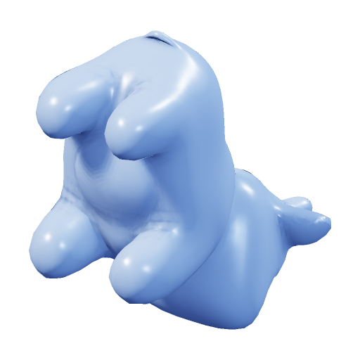
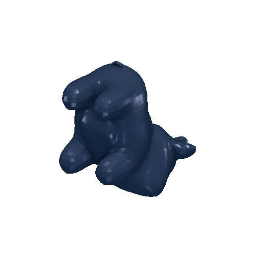
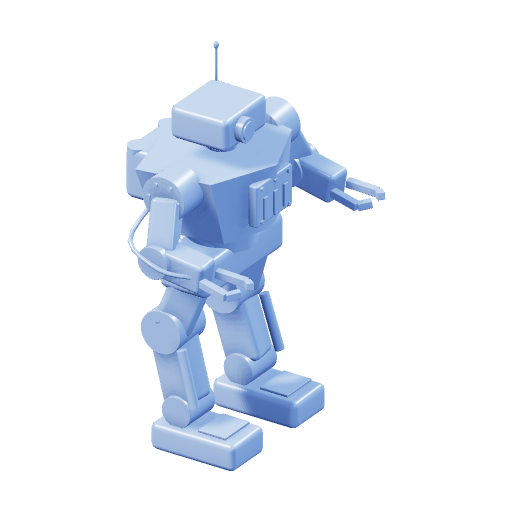
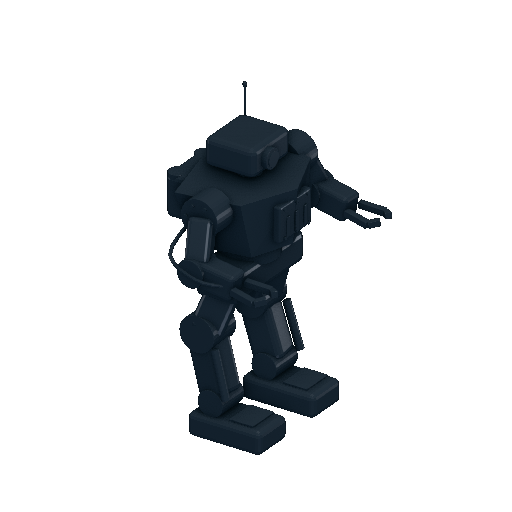
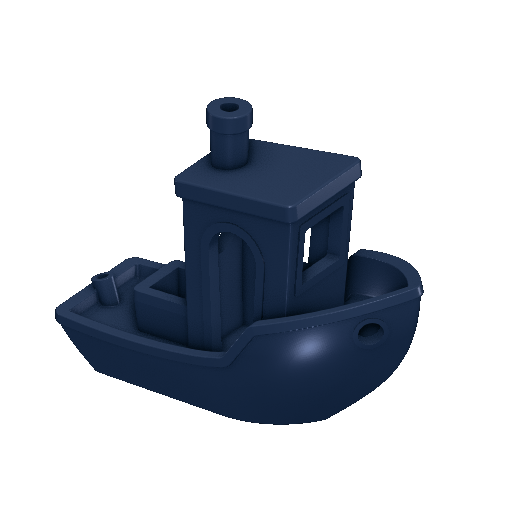

# Render.NET.Mesh and F3D

The benchmark compares complete model-to-PNG operations on the same public-domain files. It measures preview generation, including file loading, rather than interactive frame rate. The models are committed in [Tests/Fixtures](../Tests/Fixtures), and their original download URLs, public-domain declarations, and checksums are in the manifest. No F3D binaries or source code are included in Render.NET.

## Method

- Intel Core i5-12450H, 12 logical CPUs, Linux, .NET SDK 10.0.402; shared development machine, no CPU affinity or frequency locking. Results are indicative, with visible run-to-run variation.
- Official [F3D 4.0.0 Linux x86-64 release](https://github.com/f3d-app/f3d/releases/tag/v4.0.0), VTK 9.7.1. Mesa 25.2.8 reports `llvmpipe (LLVM 20.1.2, 256 bits)`, `Accelerated: no`. No GPU acceleration.
- Each F3D invocation starts its own Xvfb display and GLX context. That overhead is included. F3D can also run with other backends or a persistent process; those configurations are not measured here.
- Release builds, square transparent PNGs at 512 and 1024 pixels, orthographic cameras, the same camera direction and Z-up orientation. Each renderer performs its own automatic framing.
- Five measured runs, after one discarded process run per case. Managed and F3D process order alternates to reduce systematic order bias. Filesystem and driver caches are warm; these are **new-process timings**, not cold-disk timings.
- **Managed process** and **F3D process** are wall-clock times from process creation to exit, including loading, rendering, PNG encoding, and file writing. Managed process includes .NET startup; F3D process includes Xvfb startup.
- **Managed in-process** is load + render + PNG/file writing across repeated calls inside one .NET process. Two preliminary calls are discarded before measuring five calls. This is closer to library use in a service. It is not directly comparable to F3D process startup, and two warmups do not guarantee steady-state JIT performance.
- **Quality:** managed supersampling 2× per axis, studio lighting, self-shadows and ambient occlusion; F3D FXAA, ambient occlusion and tone mapping. **Fast:** managed supersampling 1×, no shadows/AO; F3D no post effects. These are useful configurations, not identical algorithms or equal-quality guarantees. Lighting, source materials and smooth normals can differ; Render.NET uses one caller-supplied material.

The JSON contains every timing sample, managed loading/rendering/encoding stages, exact commands, and runtime information. PNG metadata is removed losslessly after timing; image pixels are unchanged.

## Results

Times are medians of five runs, in milliseconds. The in-process column includes loading the file again on each call.

[Raw samples and commands](benchmarks/2026-10-26-f3d4.json).

### Quality profile

| Model | Triangles | Pixels | Managed in-process | Managed process | F3D process |
| --- | ---: | ---: | ---: | ---: | ---: |
| spot_triangulated.obj | 5,856 | 512 | 186 | 509 | 641 |
| spot_triangulated.obj | 5,856 | 1024 | 465 | 819 | 1023 |
| mug.3mf | 2,290 | 512 | 226 | 527 | 671 |
| mug.3mf | 2,290 | 1024 | 671 | 1685 | 1961 |
| mech.3mf | 19,116 | 512 | 373 | 978 | 1235 |
| mech.3mf | 19,116 | 1024 | 728 | 1144 | 1378 |
| dog.3mf | 35,256 | 512 | 427 | 848 | 745 |
| dog.3mf | 35,256 | 1024 | 522 | 1080 | 1135 |
| benchy.stl | 225,706 | 512 | 537 | 932 | 808 |
| benchy.stl | 225,706 | 1024 | 972 | 1529 | 1180 |

### Fast profile

| Model | Pixels | Managed process | F3D process |
| --- | ---: | ---: | ---: |
| spot_triangulated.obj | 512 | 242 | 427 |
| spot_triangulated.obj | 1024 | 313 | 571 |
| mug.3mf | 512 | 282 | 600 |
| mug.3mf | 1024 | 306 | 664 |
| mech.3mf | 512 | 593 | 612 |
| mech.3mf | 1024 | 563 | 774 |
| dog.3mf | 512 | 734 | 586 |
| dog.3mf | 1024 | 901 | 797 |
| benchy.stl | 512 | 435 | 578 |
| benchy.stl | 1024 | 544 | 685 |

On these inputs, the fast managed process is usually competitive with F3D plus Xvfb. Quality output is competitive on the smaller examples, while the dense 3DBenchy is slower: about 1.15× at 512 px and 1.30× at 1024 px. The measurements support using this library for CPU previews, but do not establish equal visual quality or a general replacement for F3D. A persistent F3D service would avoid much of the startup overhead shown here.

## Images

The images below come from the measured quality configuration. Render.NET and F3D have different lighting and framing; this is not an image-difference test.

| Model | Render.NET.Mesh | F3D 4.0 |
| --- | --- | --- |
| Spot (OBJ) |  |  |
| Robot (3MF, multiple objects) |  |  |
| 3DBenchy (STL) |  |  |

## Reproduce

Requires .NET 10, Python 3, F3D 4.0 with the Assimp 3MF plugin, Mesa software OpenGL, `xvfb-run`, and `xauth`. No Python packages are required.

```bash
python3 Benchmarks/compare.py --f3d /path/to/f3d --xvfb --output artifacts/benchmark
```

The script sets `LIBGL_ALWAYS_SOFTWARE=1`, `MESA_LOADER_DRIVER_OVERRIDE=llvmpipe`, and `GALLIUM_DRIVER=llvmpipe`. It builds the managed benchmark once, then measures the five models in both profiles and resolutions. Images and raw JSON are written under the output directory. Failed renderer processes abort the benchmark and are never counted as fast renders.

For this machine, the official portable F3D binary needed newer OpenSSL/TIFF libraries than the host provided. Matching libraries from the official `f3d-4.0.0-cp312-cp312-manylinux_2_34_x86_64.whl` release asset were extracted into a temporary directory; `LD_LIBRARY_PATH` points at its `f3d/lib64` folder. Temporary `libGLX.so` / `libOpenGL.so` symlinks point to the installed `.so.0` runtime libraries. No system packages or libraries were replaced. The raw JSON records these paths; use paths appropriate to your installation.

The system's older F3D 2.2.1 build did not provide a 3MF reader, so it was excluded from this comparison. The benchmark does not establish performance on a GPU, long-running F3D integrations, other hardware, textures, animations, or arbitrary user models.
