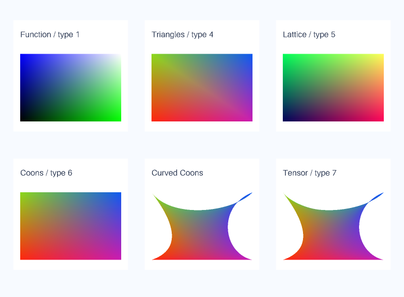
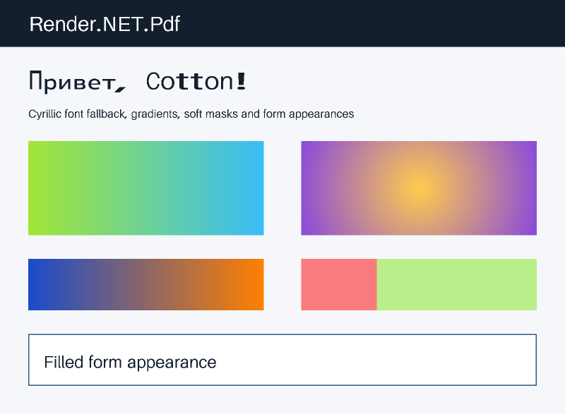
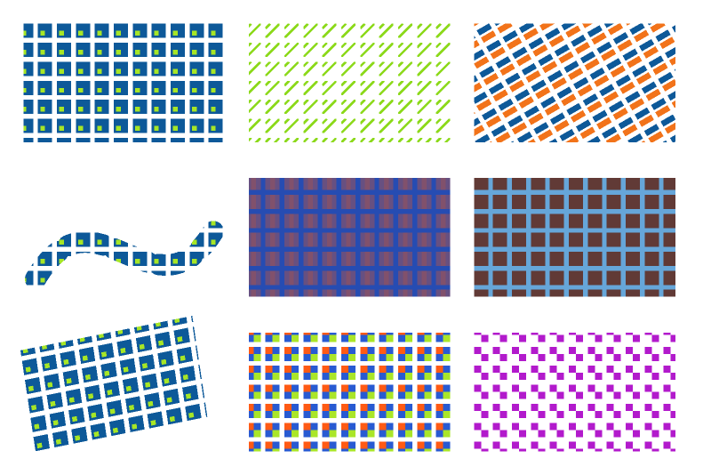
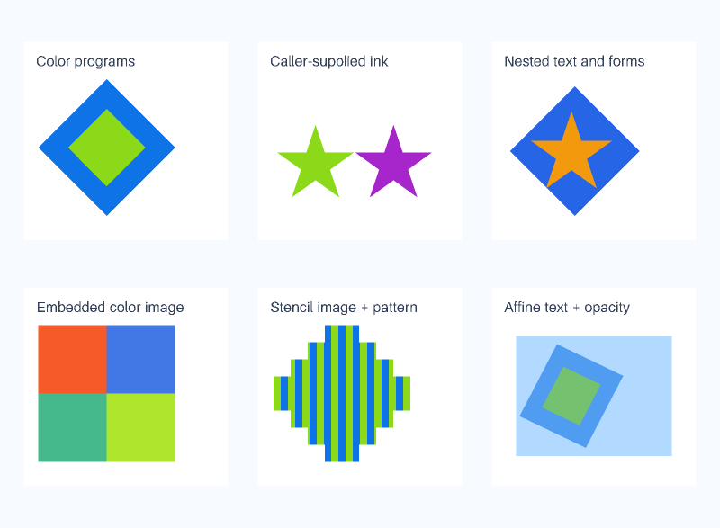

# Render.NET.Pdf

`Render.NET.Pdf` interprets PDF pages with PdfPig and draws them with Render.NET's managed CPU rasterizer. JPEG 2000 uses our dependency-free `Render.NET.Jpeg2000` decoder, JPEG decoding uses StbImageSharp, and JBIG2 uses our dependency-free `Render.NET.Jbig2` decoder. All runtime dependencies contain managed .NET assemblies. No PDFium, Poppler, Skia, System.Drawing, native graphics libraries, external processes, system font installation, or display server is needed by the package. Poppler is used only for development comparisons.

Version 0.3.9 replaces the external JBIG2 codec with our original managed decoder, including PDF globals and chained filters. See the [JBIG2 API and limits](jbig2.md).

Version 0.3.11 adds colored and uncolored tiling patterns for fills, strokes, text and stencil images, plus shading-pattern strokes. Pattern content uses our existing managed rasterizer; no new runtime dependency is introduced.

Version 0.3.13 adds function-based shadings and triangle/Coons/tensor meshes (all seven PDF shading types), including continuation flags, arbitrary color components, functions, transforms and pattern backgrounds. Mesh streams and geometry have explicit budgets; no dependency is added.

Version 0.3.12 adds Type 3 font programs through the same interpreter: colored and stencil glyphs, local resources, nested text/forms, images, affine placement and inherited graphics state. No runtime dependency is added.

Version 0.3.7 restores JP2 and raw JPEG 2000 decoding through our original managed decoder. See the [implemented subset and limits](jpeg2000.md). CoreJ2K was removed in 0.3.6 because its source retains JJ2000 conditions beyond its advertised BSD license; version 0.3.5 still has that dependency.

The remaining PDF runtime dependencies are PdfPig 0.1.16 (Apache-2.0 with additional component notices) and StbImageSharp 2.30.16 (Unlicense OR MIT). Their license texts and upstream notices are included in the PDF package as `ThirdPartyNotices.txt`. The bundled fonts are public domain/CC0; their provenance is recorded separately below. Preserve the applicable licenses and notices when redistributing dependency binaries. Render.NET's own code remains MIT.

This is an initial PDF renderer, not a complete implementation of every PDF imaging feature. It reports known unsupported constructs rather than silently claiming a faithful preview.

## Read and render

```csharp
using Render.NET;
using Render.NET.Pdf;

using PdfDocument document = await PdfReader.ReadFileAsync("report.pdf",
    new PdfReaderOptions { Password = "document-password" }, cancellationToken);

Console.WriteLine(document.PageCount);
PdfPage page = document.GetPage(1, cancellationToken);

PixelBuffer preview = PdfRenderer.Render(page, new PdfRenderOptions
{
    Dpi = 144,
    MaximumWidth = 1600,
    MaximumHeight = 2000,
    Supersampling = 2,
    Background = new Rgba32(255, 255, 255)
}, cancellationToken);

await using var output = File.Create("page.png");
await PngEncoder.WriteAsync(preview, output, cancellationToken);
```

Page numbers start at **1**. `Width` and `Height` are the visible page dimensions in points (72 points per inch), after crop, rotation, and `/UserUnit`. DPI determines output size; maximum width and height only reduce it, keeping the aspect ratio. Pixel dimensions round upward. Background defaults to opaque white; use `Background = default` for transparent output.

`PdfReader.ReadAsync` reads from a stream's current position, accepts non-seekable input, and leaves the caller's stream open. `GetPage` interprets one page and copies the data it needs. The returned page can render repeatedly and concurrently, including after document disposal. Access to one document's parser is serialized; separate documents can be read independently. There is no automatic page cache.

Supersampling is 1–4, default 2. Rendering occurs at the enlarged resolution and downsamples with alpha-weighted colors into straight-alpha RGBA8. PNG output has only IHDR, IDAT, and IEND chunks.

## Support matrix

| Feature | Supported rendering |
| --- | --- |
| PDF structure | PdfPig's cross-reference tables/streams, compressed object streams, content stream arrays, and password handling. |
| Page geometry | Inherited resources, crop/media boxes, crop origins, 0/90/180/270-degree page rotation, UserUnit. |
| Paths | Lines, rectangles, cubic curves; nonzero and even-odd fills; combined fill/stroke. |
| Strokes | Affine pen transforms, hairlines, butt/round/square caps, miter/round/bevel joins, miter limits, dash arrays and phases. |
| Text | Embedded TrueType, Type 1, and CFF outlines when exposed by PdfPig; positioned strings, text matrices, rotation, spacing, fill/stroke/invisible/clip modes. No hinting. |
| Type 3 fonts | CharProcs with d0/d1 metrics, font encoding/matrices, colored and stencil glyphs, local resources, paths, nested text/forms, color images in d0 glyphs and image masks in either kind. Text mode 3 hides glyphs; other text modes leave their programs' painting unchanged. |
| Missing fonts | Bundled CC0 Aileron and Canada 1500 regular/bold/italic/bold italic substitutes, including Cyrillic and Greek, or caller-provided TrueType fonts. Original PDF advance widths are preserved. |
| Images | JPEG 2000 (JP2/raw J2K, including embedded opacity), JPEG, JBIG2 (including indirect/compressed global symbol dictionaries and filter chains), raw/Flate/LZW/ASCII85/ASCIIHex/RunLength/CCITT data supported by PdfPig; inline images; 1/2/4/8/16-bit samples; RGB, gray, CMYK, indexed, and other color spaces exposed by PdfPig. |
| Image masks | Stencil masks, image soft masks (including different sizes), sample Decode arrays, color-key masks for sample images. |
| Forms | Nested Form XObjects, local resources, matrices, bounding boxes, graphics state save/restore. |
| Gradients | All seven shading types: function-based, axial/radial, free/lattice triangle meshes, Coons and tensor-product patches. Domains/functions, extension, bounding boxes, transforms, patch/triangle continuations and backgrounds in shading patterns. |
| Patterns | Colored and uncolored (stencil) tiling patterns, RGB/gray/CMYK and other parser-supported base color spaces, positive/negative spacing, cell BBox clipping, pattern matrices, local fonts/images/forms and nested patterns. Fill, stroke, text and image-mask painting; shading-pattern strokes. |
| Annotations and widgets | Normal appearance streams, selected appearance states, local fonts/resources, transformed bounding boxes mapped into annotation rectangles, hidden/invisible/NoView flags. Existing filled-field appearances are rendered. |
| Clipping | Intersections, empty clips, text clipping at ET, graphics state restoration. |
| Transparency | Constant fill/stroke alpha, all 16 PDF blend modes, isolated and non-isolated transparency groups including knockout with opacity applied once, alpha/luminosity graphics-state soft masks with backdrop and transfer functions. |
| Color conversion | PdfPig's conversion to RGB composite output. Print overprint controls do not reject RGB rendering; no color-managed ICC/proofing or CMYK print fidelity guarantee. |

Optional-content groups use the default document configuration: base state, explicit ON/OFF lists, view-usage applications, membership policies and nested visibility expressions. Hidden marked content, form XObjects and annotation appearances do not paint.

Known unsupported rendering features include JPEG 2000 extensions listed in the codec documentation, shading-pattern graphics-state overrides, annotation NoZoom/NoRotate flags, and JPEG Decode arrays/color-key masks. Form values without a normal appearance stream are reported, including inherited values; the renderer does not generate missing appearances. JBIG2 segments with unknown lengths and striped pages with unknown height are reported as unsupported. Missing outlines are reported; absent Type 3 CharProcs intentionally paint nothing, as required by the format. Documents can contain additional producer-specific features not recognized by this implementation; a clean feature list is not a general PDF conformance guarantee.

Hyperlink actions, scripts, attachments, and interactive forms are not executed. Existing annotation and form appearances are painted after page content. Actions and field calculations are not run. Ordinary links without appearance streams do not add a generated border or highlight.

```csharp
foreach (string feature in page.UnsupportedFeatures)
    Console.WriteLine(feature);

// Explicitly opt into a potentially incomplete preview.
PixelBuffer partial = PdfRenderer.Render(page,
    new PdfRenderOptions { AllowPartialRendering = true });
```

The default throws `NotSupportedException` when `UnsupportedFeatures` is nonempty. Partial rendering skips unsupported image codecs and shadings and approximates other reported operations; it does not make them supported. Malformed documents and exhausted limits still fail.

## Knockout transparency

Knockout form groups (`/K true`) composite each elementary object against the group's initial backdrop. Shape is tracked separately from opacity, including fully transparent paths, shader domains, nested groups and fractional image alpha. Object buffers are reused and only their painted bounds are reset/composited. The original `knockout.pdf` covers isolated, non-isolated Multiply and zero-opacity overlap. Group color-space overrides and text-knockout overrides remain outside this RGB preview implementation. Print overprint simulation is not applied to RGB composite output, following ISO 32000-1 §8.6.7: a device without overprint support ignores the print overprint parameters. Their presence does not require partial rendering. CMYK separations, spot-ink proofing and color-managed printing remain outside the output contract. See the [PDF specification](https://opensource.adobe.com/dc-acrobat-sdk-docs/pdfstandards/PDF32000_2008.pdf).

## Mesh and function shadings

Function shadings evaluate the PDF function in both input coordinates at each sample. Triangle meshes interpolate the source color components or the function parameter before color conversion/function evaluation. Geometry comes from the decoded stream; all permitted coordinate/component/flag widths and continuation edges are handled. Mesh overlap is sampled once per shading, preserving outer opacity at shared edges. A spatial hierarchy accelerates triangle lookup.

Coons and tensor patches use shared uniform subdivisions, selected from device-space curve error (target 0.2 sample pixels, up to 128 subdivisions per axis). The minimum is eight; color interpolation and curvature remain numerical approximations. Tessellation may reach its bound on very large or highly folded patches. It is rebuilt for each render resolution and subject to the geometry/memory limits. `MaximumShadingBytes` defaults to 64 MiB for decoded mesh streams and stored geometry per page, and also bounds temporary triangle storage per invocation. Reader parsing/decompression still has the limitations described below.

The original `shadings.pdf` and standard-library generator cover types 1 and 4–7, including curved patches. Our 800 x 587 render at 96 DPI/2x supersampling compared with Poppler Cairo has mean absolute RGB error 1.22/255; 98.65% of pixels differ by at most 8 per channel. This is a synthetic regression comparison, not a broad conformance result.



## Tiling patterns

Graphics-state and compositing behavior follows sections 8.7.2, 8.7.3 and 11.6.7 of the [PDF 1.7 specification](https://opensource.adobe.com/dc-acrobat-sdk-docs/pdfstandards/PDF32000_2008.pdf).

Patterns stay anchored to the initial coordinate system of their page, form or parent pattern; subsequent `cm` operators move the painted shape without moving the pattern grid. Cell content inherits the parent's initial graphics state, with transparency reset to its defaults. Uncolored cells receive their separately specified ink in both fill and stroke state. Color-setting operators and ordinary color images inside an uncolored cell are rejected as invalid PDF; image masks are permitted.

Tiling types 1 and 3 can reuse a rasterized cell when its objects use Normal blending and cells do not overlap. Cell texture size is bounded by the current canvas sample count. Type 2 retains vector geometry without raster-cell resizing. Backdrop-dependent blends, overlapping cells and oversized textures replay the cells into one non-isolated group, with the outer alpha/blend/soft mask applied once. Rotation, sampling and device pixel rounding can differ from another renderer; this is not a print-conformance claim for device-dependent tiling hints.

Replay considers the visible clipping rectangle and is limited to 4,096 candidate cells and 1,000,000 stored command replays per invocation. Pattern/soft-mask interpretation is limited to eight nested captures; recursive patterns fail. Cell operations, paths and decoded images also count against the page reader limits. These are resource limits, not unsupported-feature warnings, and `AllowPartialRendering` does not bypass them.

## Fonts

Type 3 fonts execute their embedded PDF drawing programs instead of requesting an outline or a substitute font. Graphics state, paths, text matrices and resources are scoped to each invocation. The font matrix controls placement; its translation does not add to advance widths. A zero font-wide FontBBox does not hide the glyph. Stencil (`d1`) programs inherit fill/stroke ink, including patterns; their color operators are ignored according to section 9.6.5 of the [PDF specification](https://opensource.adobe.com/dc-acrobat-sdk-docs/pdfstandards/PDF32000_2008.pdf). Ordinary color images in a stencil program and invalid/repeated/misplaced d0/d1 metrics fail as malformed input. Glyphs share the eight-level pattern/mask interpretation bound, reject recursion and count against page operation, geometry and image budgets. Internal glyph programs are cached per interpreted page; there is no hinting or device-font raster cache.

Embedded font outlines are used directly. Standard PDF fonts are often named without embedding their outlines. The package includes four [Aileron](https://dotcolon.net/font/aileron/) faces, dedicated to the public domain under CC0 by Sora Sagano, and four [Canada 1500](https://typodermicfonts.com/canada1500/) faces released under CC0 by Raymond Larabie. Aileron remains the Latin substitute; Canada 1500 supplies missing Cyrillic, Greek, and other covered Unicode glyphs. Glyph coverage is checked against the cmap; a missing-glyph box is not accepted as a successful substitute. Their source URLs and SHA-256 checksums are recorded in `Sources/Render.NET.Pdf/Fonts/provenance.json`. No third-party copyrighted document content is included in the PDF fixtures.

Aileron is a sans-serif substitute, including when a missing font is serif or monospaced. Glyph appearance can therefore differ from the original even though PDF advance widths are preserved. `page.SubstitutedFonts` lists font names that required replacement. A bundled font cannot cover every Unicode character; missing outlines are reported as unsupported.

Supply a matching TrueType face when the exact typeface matters:

```csharp
byte[] replacement = await File.ReadAllBytesAsync("MyFont.ttf", cancellationToken);
using PdfDocument document = await PdfReader.ReadFileAsync("report.pdf",
    new PdfReaderOptions
    {
        FontResolver = pdfFontName => pdfFontName.Contains("MyFont")
            ? replacement : ReadOnlyMemory<byte>.Empty
    }, cancellationToken);
```

The resolver is called only when PdfPig cannot provide an embedded outline. Returning empty memory selects the bundled substitute. Font files remain caller-owned input.

## Limits and cancellation

Defaults: encoded PDF input 128 MiB; executed graphics operations 1,000,000 per page including forms; stored vector commands 1,000,000 including glyphs; a single decoded image 16,777,216 pixels; total decoded image storage 128 MiB per page; graphics state nesting 64; compositing layers and nested soft-mask interpretation eight. Core paths also cap flattened geometry at 1,000,000 segments and dashed strokes at 100,000 pieces per contour.

Transparency groups and soft masks allocate temporary canvas-sized buffers. Non-isolated layers also retain the backdrop and group coverage. The eight-layer bound limits nesting; `MaximumSamples` is the size of a single canvas, not a total peak-memory cap.

The output budget defaults to 16,777,216 samples, **including supersampling**. For example, 2× antialiasing uses four samples per output pixel. Adjust `MaximumSamples` deliberately when rendering large pages.

Reader limits are configurable through `PdfReaderOptions`; output limits through `PdfRenderOptions`. Cancellation is checked during input reads, operation/glyph/image interpretation, our JPEG 2000/JBIG2 decoding, pattern-cell replay, clipping-bound scans, scanline painting, curve flattening, dashed strokes, and downsampling. PdfPig's internal parsing/decompression and StbImageSharp's JPEG decode are synchronous and cannot be interrupted midway by this token. Input, interpreted-geometry, and decoded-image limits do not bound every temporary parser/decoder allocation. Use an isolated worker with external time/memory limits for untrusted documents.

## Command-line example

```bash
dotnet run --project Samples/Render.NET.Pdf.Sample -c Release -- \
  report.pdf page.png --page 2 --dpi 144 --width 1600 --supersampling 2
```

Optional flags: `--transparent` and `--allow-partial`. The CLI writes feature warnings to stderr and reports page count, output dimensions, elapsed time, and substituted fonts.

## Verification fixtures

`Tests/Fixtures/Pdf` contains twelve documents authored for this repository: vector graphics/clipping and alpha, embedded and substituted text, JPEG/inline/soft-masked images, a complete typeset preview, optional content, a password-protected document, codec scans (JP2, raw JPEG 2000, and JBIG2), a JBIG2 scan with global symbols, a compatibility page with unembedded Cyrillic, gradients, a luminosity mask, group opacity and a filled widget, a tiling-pattern page, a Type 3 font page, and a six-panel shading page. Their deterministic generators, original synthetic scan, encoded scan inputs, and SHA-256 manifest are committed. `generate_patterns.py` and `generate_type3.py` use Python's standard library only. The JBIG2 global-symbol round trip is tested pixel-for-pixel against the original synthetic scan. Tests run offline after package restore; Python, ReportLab, Pillow, Poppler and Ghostscript are development tools only and are not runtime package dependencies.

The preview was also rendered with Poppler at 96 DPI and inspected side by side. Both outputs are 720 × 854. On this fixture, mean absolute RGB channel error is 1.54/255 and 96.78% of pixels differ by at most 8 in every channel. This is one regression comparison, not a broad claim of PDF rendering equivalence. Font hinting and edge coverage differ.



The original nine-panel `patterns.pdf` covers colored/stencil patterns, rotation, patterned dashed strokes, internal/outer alpha, Multiply against the page backdrop, nested forms/patterns, color images and stencil images. At 96 DPI with 2x supersampling our output and Poppler 24.02.0 are both 800 x 534; mean absolute RGB error is 4.60/255 and 90.29% of pixels differ by at most 8 in every channel. Differences remain around densely repeated edges and pixel-grid placement. This single synthetic comparison does not establish compatibility with arbitrary PDF files.



The original `type3.pdf` covers colored/stencil glyphs, inherited ink, nested text/forms, color and stencil images, patterns, affine placement and opacity. At 96 DPI and 2x supersampling, our 800 x 587 output has mean absolute RGB error 1.46/255 against Ghostscript and 2.50/255 against Poppler's Cairo output. Pixel agreement within 8 in every channel is 97.93% and 95.92%, respectively. These references also disagree: Poppler 24.02.0's Splash output paints the stencil-image pattern across the page, and its Cairo output differs on inherited Type 3 opacity. Our tests independently check pattern coverage, inherited alpha and spacing against equivalent vector operations. These synthetic comparisons are regression evidence, not a general conformance claim.


