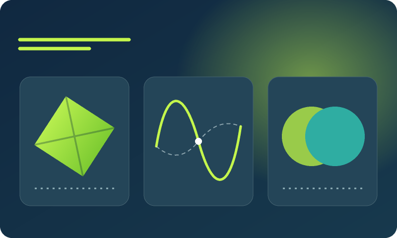
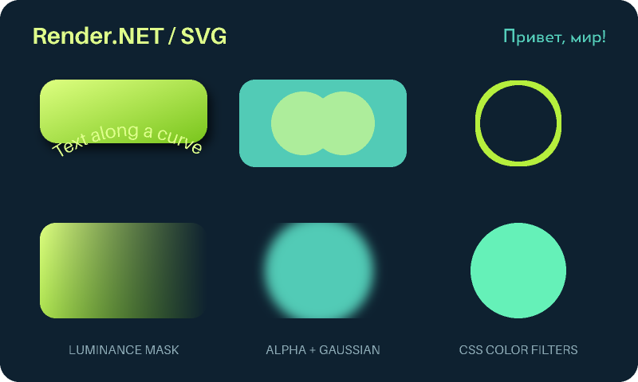

# SVG → PNG

`Render.NET.Svg` interprets static SVG vector scenes and renders them through the managed Render.NET canvas. Targets .NET 10; its only package dependency is `Render.NET`. It does not need a browser, display server, GPU, native graphics library or external process at runtime.

[CPU benchmarks against Svg.Skia/SkiaSharp](svg-benchmarks.md) include fresh-document timings and the 0.3.19 fix for Cotton's 20-second effects-preview timeout. Axis-aligned blur uses exact scanline convolution; morphology uses linear-time extrema windows. Arbitrarily rotated/skewed filters retain the general sampling path. Both paths preserve the existing color-space, alpha and edge behavior.

```csharp
using Render.NET;
using Render.NET.Svg;

SvgDocument document = await SvgReader.ReadFileAsync("drawing.svg", cancellationToken: token);
PixelBuffer image = SvgRenderer.Render(document, new SvgRenderOptions
{
    Width = 1024, // Supplying only width preserves intrinsic proportions.
    Supersampling = 2,
    Background = default // Transparent RGBA.
}, token);
await using Stream output = File.Create("drawing.png");
await PngEncoder.WriteAsync(image, output, token);
```

`SvgReader.Read(string)`, `ReadAsync(Stream)` and `ReadFileAsync` produce an independent scene that can be rendered concurrently after its input stream is disposed. Streams remain caller-owned. Rendering has no shared mutable canvas. `SvgPathParser.Parse` and `SvgPathWriter.Write` also convert path data independently of a document.

## Supported scene features

| Area | Support |
| --- | --- |
| Geometry | All absolute/relative SVG path commands, implicit command repetition, smooth cubic/quadratic curves, elliptical arcs with radius correction, multiple contours, rectangles with rounded corners, circles, ellipses, lines, polygons and polylines. |
| Painting | Solid CSS named/hex/RGB/RGBA colors, currentColor, inherited fill/stroke, fill/stroke opacity, atomic group opacity, nonzero/evenodd fills, affine strokes, caps/joins/miter limits, dash patterns and offsets. |
| Gradients | Linear/radial, source/focal circles, objectBoundingBox and userSpaceOnUse coordinates, stops/stop opacity, inherited gradient definitions, gradient transforms, pad/repeat/reflect, sRGB and linearRGB interpolation. |
| Scene | Root viewport/viewBox and preserveAspectRatio, affine transforms, groups, local use/symbol references including symbol viewBox, clipPath with local/object-box coordinates. |
| Text | TrueType outlines, Unicode Latin/Cyrillic fallback, composite glyphs, legacy/GPOS pair kerning, family/weight/style resolution, font shorthand, tspan positioning, anchor/baseline/spacing, textLength, textPath and basic decorations. |
| Masks | Alpha/luminance, inversion through filter graphs, object-box/user-space units, group opacity, nested references and cycle detection. |
| Filters | Gaussian blur, drop shadow, offsets, color matrices, component transfer, Porter–Duff/arithmetic compositing, blend/merge/flood, morphology, convolution, displacement, turbulence, diffuse/specular lighting, feImage and feTile. Named results and Source/Background/FillPaint/StrokePaint inputs. CSS color/blur functions. |
| Images | Embedded PNG (all standard color types and depths, transparency, Adam7), aspect-ratio placement and caller-controlled image resolution. |
| Styles | Presentation attributes, inline style, embedded CSS rules with element, class, id, universal and compound simple selectors, specificity and source order. |

Patterns, markers, SVG animation, nested SVG viewports, complex CSS selectors, CSS drop-shadow syntax, CFF/WOFF2 fonts and complex-script/vertical/Bidi text shaping remain outside the supported subset. TrueType-flavored TTF/OTF, TTC (first face) and WOFF1 are accepted by `FontResolver`. Basic decoration positions and fallback font metrics can differ from the original font. This is not an SVG conformance claim. Unsupported elements/properties are collected in `document.UnsupportedFeatures`; rendering rejects that list by default. `AllowPartialRendering = true` explicitly opts into an incomplete preview. Scripts/actions are never executed; external references are not fetched.

The bundled Aileron and Canada1500 faces are the same CC0 assets used by Render.NET.Pdf; file hashes and original public-domain declarations are shipped in `fonts/provenance.json`. No font engine or SVG/filter implementation was imported. A caller can supply font bytes with `new SvgReaderOptions { FontResolver = request => fonts.GetValueOrDefault(request.Family) }`, or supply decoded images with `ImageResolver`. Resolver results are copied during reading; no implicit file/network access occurs.

Editor metadata does not require partial rendering. Elements in foreign namespaces (including Inkscape, Sodipodi and RDF), SVG `title`/`desc`/`metadata` and legacy `namedview` subtrees are ignored without indexing their IDs or applying their styles. Namespaced editor attributes and namespace declarations do not become SVG presentation properties; `xml:space` and `xlink:href` retain their defined behavior. Input element/depth limits still include ignored subtrees. Unsupported SVG drawing elements and properties continue to reject strict rendering. The original `Tests/Fixtures/Svg/editor-metadata.svg` and namespace regression tests cover this behavior; six existing Cotton/Cotton Mobile icon and splash SVGs, including two Inkscape documents, were also rendered in strict mode.

Clip paths union independently filled child geometry, preserving each child's clip rule. Nested clipping inside clipPath is diagnosed rather than claimed as supported. Gradient bounds are numerical, using 0.01 user-unit flattening. Curves are flattened again at device resolution during rasterization; antialiasing uses premultiplied-alpha downsampling.

## Limits and cancellation

`SvgReaderOptions` defaults: 16 MiB encoded UTF-8 input, 100,000 XML/expanded scene elements, 1,000,000 stored path commands, depth 64 and 16,777,216 decoded pixels per image. Local references reject cycles and expanded instances count against the limits. DOCTYPE declarations are accepted without loading DTDs. Declared entities are not expanded, and XML resource resolution is disabled. XML parsing is synchronous and bounded by input size; its inner parser is not interrupted by the cancellation token. Cancellation is checked during scene interpretation, path parsing, painting and downsampling.

`SvgRenderOptions.MaximumSamples` defaults to 16,777,216 samples **including** supersampling. Supersampling is 1–4. At most eight nested opacity/compositing layers and 64 canvas clipping saves are supported. `MaximumEffectBytes` defaults to 256 MiB of live mask/filter temporary buffers, including cached floating-point blur samples. Filter graphs allow 128 primitives, blur/morphology up to 256 device samples, convolution kernels up to 31 × 31 and turbulence up to 12 octaves. Opacity layer buffers add temporary memory; a sample budget is not a total process-memory limit. Run hostile inputs in an isolated worker with an external memory/time limit.

## Original reference scene

`Tests/Fixtures/Svg/vector-preview.svg` was authored for this repository with no imported artwork, fonts or external assets. At 800 × 480 with 2× supersampling, comparison with system librsvg/Cairo gives mean absolute **premultiplied RGB** error 0.1605/255; 99.609% of pixels differ by at most 8 per color channel. This synthetic comparison checks the illustrated features; it does not establish compatibility with arbitrary SVG files.



```bash
dotnet run --project Samples/Render.NET.Vector.Sample -c Release -- \
  drawing.svg drawing.png --width 1024 --supersampling 2
```

Parsing and arc conversion follow the [SVG 2 paths](https://www.w3.org/TR/SVG2/paths.html), [painting](https://www.w3.org/TR/SVG2/painting.html) and [coordinate systems](https://www.w3.org/TR/SVG2/coords.html) specifications. No external SVG implementation is included in the package.

## Text and effects regression scene

`Tests/Fixtures/Svg/effects-preview.svg` adds Cyrillic/Latin text, text along a curve, group opacity, alpha/luminance masks, Gaussian blur, drop shadow, morphology/compositing and CSS filters. It is original artwork. Its output is compared with Chrome's native SVG renderer; librsvg uses different CSS filter color handling and does not display this scene's SVG2 `href` textPath. Reference programs are development tools only. `Tests/Fixtures/Svg/Png` contains 30 deterministic standard-library-generated PNG cases covering color types, bit depths, row filters and Adam7, plus SHA-256 hashes.



Filter algorithms follow [Filter Effects](https://www.w3.org/TR/filter-effects-1/), masking follows [CSS Masking](https://www.w3.org/TR/css-masking-1/), and font outlines follow the [OpenType glyf specification](https://learn.microsoft.com/en-us/typography/opentype/spec/glyf). Numerical blur kernels, flattened outlines and eight-bit intermediate buffers can produce differences from other renderers.
