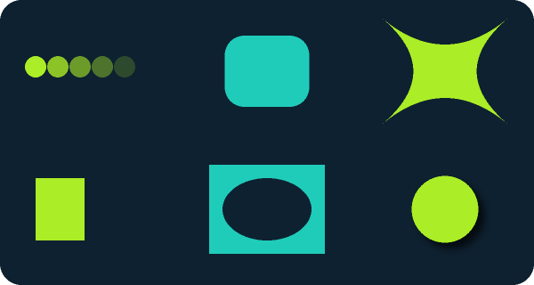

# TGS / Lottie → PNG frames and animation

`Render.NET.Tgs` reads gzip-compressed Telegram `.tgs` and uncompressed Lottie JSON, evaluates one selected frame and renders its vector scene through `Render.NET.Svg` and the managed raster canvas. No native animation engine, browser or external renderer is used at runtime. Expression execution uses Jint 4.17.0 (BSD-2-Clause) and its Acornima 1.7.0 parser (BSD-3-Clause). Their notices are included in the NuGet package.

```csharp
using Render.NET;
using Render.NET.Svg;
using Render.NET.Tgs;

TgsDocument animation = await TgsReader.ReadFileAsync("sticker.tgs", cancellationToken: token);
var options = new SvgRenderOptions { Width = 512, Supersampling = 2 };
PixelBuffer frame = TgsRenderer.RenderFrame(animation, frame: 30, options, token);
// Or elapsed seconds from the composition's first frame:
// PixelBuffer frame = TgsRenderer.RenderAtTime(animation, seconds: 0.5, options, token);

await using Stream output = File.Create("frame.png");
await PngEncoder.WriteAsync(frame, output, token);
```

Frame numbers are absolute, allow fractional values and must be in `[InPoint, OutPoint)`. Elapsed time starts at the composition's in-point. `Width`, `Height`, `FrameRate`, `InPoint`, `OutPoint` and `Duration` expose composition metadata. Output size, transparent/background color, antialiasing and sample limits use `SvgRenderOptions`. `RenderFrames` provides a lazy sequence for animation encoders.

The document owns an immutable copy of its JSON and can be rendered concurrently after the source stream is disposed. `Read`, `ReadAsync(Stream)` and `ReadFileAsync` accept both formats; gzip is detected from its signature. Streams remain caller-owned.

## Expressions and animation

```csharp
TgsDocument animation = await TgsReader.ReadFileAsync("sticker.tgs", cancellationToken: token);

IEnumerable<TgsFrame> frames = TgsRenderer.RenderFrames(animation,
    new TgsAnimationOptions { FrameRate = 30, MaximumFrames = 300 },
    new SvgRenderOptions { Width = 512, Supersampling = 2 }, token);

int index = 0;
foreach (TgsFrame frame in frames)
{
    await using Stream output = File.Create($"frame-{index++:D5}.png");
    await PngEncoder.WriteAsync(frame.Image, output, token);
}
```

`TgsFrame` carries source frame number, timestamp relative to the composition's in-point, display duration, image and detected feature warnings. `StartTime` and `Duration` select a range; output FPS can differ from source FPS. Frames render one at a time and enumeration checks cancellation. An external encoder such as FFmpeg can consume the PNG sequence:

```sh
ffmpeg -framerate 30 -i frame-%05d.png -c:v libwebp_anim -loop 0 -an sticker.webp
```

No image/video encoder or FFmpeg process is bundled or launched by the library. `RenderFrameDetailed` returns the same diagnostics for a selected frame; `RenderFrame` continues to return only its pixel buffer.

Default playback uses the saved property values and animated keyframes in `k`. Exported expression strings in `x` are not compiled or executed and do not require partial rendering. Position, path and color keyframes continue to interpolate normally, including when an expression references a controller absent from the exported composition.

Enable bounded expression execution explicitly when it is required:

```csharp
TgsDocument animation = await TgsReader.ReadFileAsync("animation.json",
    new TgsReaderOptions { Expressions = new TgsExpressionOptions() }, token);
```

The expression environment supports exported `$bm_rt` JavaScript expressions, scalar/vector arithmetic helpers, `time`, `value`, `numKeys`, `key`, `nearestKey`, `valueAtTime`, `velocityAtTime`, composition layer lookup, effect control lookup, transform properties, parent access and 2D `toComp`. Base path values interpolate vertices and relative tangents. Property dependencies resolve lazily, and precomposition expressions use remapped composition time. Unused control expressions do not run. This is a subset of the After Effects expression environment. When execution is enabled, missing layers/properties, unsupported APIs and exhausted budgets fail; execution errors do not switch playback to saved values. A script's own `try/catch` retains its authored behavior.

The interpreter has no enabled CLR access, host file or network API. Defaults per property are 50,000 statements, 32 MiB allocations, depth 32 and one second; one frame allows 256 evaluations and five seconds of expression processing. Options expose these bounds. Dependency cycles fail, cancellation propagates, and results must match their property's numeric/vector/path type and size bounds. These limits do not replace process isolation for untrusted input. The document stays immutable and concurrent frames use independent execution contexts.

## Supported subset

| Area | Support |
| --- | --- |
| Animation | Static/animated scalar, vector and color properties; hold/linear/cubic temporal easing including per-component handles; split positions; cubic spatial motion sampled by arc length; matching-topology Bezier path morphs. |
| Layers | Shape, solid, null and precomposition layers; reverse paint order; in/out points, parent transforms, anchor/position/scale/rotation/skew, atomic opacity and automatic path orientation; precomp start/stretch and time remapping; precomp viewport clipping. |
| Shapes | Bezier paths with relative tangents, ellipses, rounded rectangles, rounded polygon/star geometry and fractional star point counts, nested groups, inherited outer styles and atomic opacity across translucent styled subgroups. |
| Paint | Solid fills/strokes, nonzero/evenodd, line width/caps/joins/miter limits, animated dashes, linear/radial gradients with color/opacity stops and radial highlight. |
| Modifiers | Parallel/sequential trim paths with wrapping offset; repeaters with transforms and opacity; merge/add/subtract/intersect/exclude paths; round corners, offset paths, Pucker & Bloat and sharp/smooth Zig Zag. |
| Masks/mattes | Multiple additive/subtractive/intersection/difference/lighten/darken masks; inverse masks, animated opacity/expansion/feather; alpha/luma track mattes and inverse mattes, including explicit matte layer selection; alpha Set Matte effects with hidden source layers and inversion. |
| Effects/compositing | Roughen Edges in Roughen mode with static, unstretched, unshifted fractal noise; all 18 Lottie layer blend modes; grouped Tint, Fill, Stroke, Tritone, Levels, Drop Shadow, Gaussian Blur (including the legacy export) and Transform effects with animated parameters. |

Slots, text/image layers and external assets, 3D, effect IDs outside the documented list, and Twist remain outside this implementation. Morphs with different vertex counts are rejected. Simultaneous trims reach separately styled subgroups. Sequential trims split across interleaved style scopes or separately styled subgroups are diagnosed. Set Matte channel extraction and alpha replacement remain unsupported. Fractional stars and flattened path offsets may differ numerically between players. This is a managed vector preview implementation, not full After Effects/Lottie conformance.

`animation.UnsupportedFeatures` reports features detectable while reading. Frame-dependent unsupported combinations can also throw while evaluating the selected scene. Rendering rejects known unsupported features by default; `AllowPartialRendering = true` opts into a potentially incomplete preview. Saved-value playback is the default; expressions run only when `TgsReaderOptions.Expressions` is supplied. External assets are never fetched.

Motion paths use a 64-segment arc-length lookup. Trim paths flatten curves at 0.1 user-unit tolerance. SVG/raster curve and gradient approximations also apply. Numerical differences from another animation player are expected around curved edges and trimmed endpoints.

## Limits and verification

Reader defaults: 16 MiB encoded input, 32 MiB decoded JSON, 500,000 JSON values/expanded scene items, depth 64 and 1,000,000 generated path commands. Gzip output is checked incrementally; parent/precomp cycles fail. Geometry expansion, painting and reads check cancellation. JSON parsing is synchronous and bounded by decoded size; it cannot be interrupted midway. SVG canvas/output limits also apply. Repeaters allow up to 4,096 copies, Zig Zag up to 4,096 ridges per source segment; boolean geometry allows 16,384 flattened edges and two million candidate intersections. Effect buffers use `SvgRenderOptions.MaximumEffectBytes`. These bounds do not replace an isolated worker's process memory/time limits for hostile input.

`Tests/Fixtures/Tgs` contains an original two-second orbit scene as JSON and deterministic gzip TGS, its standard-library generator and a SHA-256 manifest. It uses no imported stickers, fonts or artwork and is covered by the repository MIT license.

At 512 × 512 with 2× supersampling, frames 0/30/60/90 were compared with **lottie-web 5.13.0's SVG renderer in headless Chrome**. Mean absolute premultiplied RGB error is 0.1440–0.1889/255; 99.246–99.448% of pixels differ by at most 8 in every color channel. The same JSON was used by both renderers. The reference player/browser are development tools only; they are not dependencies or shipped code. This one synthetic animation is regression evidence, not broad format conformance.


```bash
dotnet run --project Samples/Render.NET.Vector.Sample -c Release -- \
  sticker.tgs frame.png --frame 30 --width 512
# Or --time 0.5. Optional: --opaque, --allow-partial.
```

Implementation follows the [Lottie community format specification](https://lottie.github.io/lottie-spec/latest/), including its property interpolation and shape rendering model.

## Effects and modifier regression scenes

`effects.json`/`.tgs` add repeaters, rounded corners, Pucker & Bloat, multiple masks, an inverse alpha matte and drop shadow. `geometry.json`/`.tgs` cover rounded stars/polygons and sharp/smooth Zig Zag on a cubic curve. The original scenes and deterministic standard-library generator `generate_effects.py` are committed with SHA-256 manifests. Reference comparison uses lottie-web 5.13.0 SVG in Chrome with an expanded filter region; no player code or third-party artwork is shipped. Mask feather has separate pixel tests because the reference SVG player does not implement it.



Merge/offset operations use our own managed planar edge arrangement in `VectorPath.Combine`, `Offset` and `RoundCorners`; they do not depend on a third-party geometry library. Rounded corners/offsets flatten curves at 0.05 user-unit tolerance; boolean operations default to 0.1. Geometry budgets and cancellation also apply to these operations.

## Sticker regression inputs

`Tests/Fixtures/Tgs/Stickers` contains 15 compressed Telegram sticker files and a SHA-256 manifest. All 15 are rendered with default saved-value playback at five timeline positions. The regression tests cover hidden video layers, translucent groups, inherited simultaneous trim paths, parameter-only controllers, identity hue/saturation and empty puppet effects, legacy Gaussian Blur and alpha Set Matte. Opt-in expression regressions cover elastic controls and path expressions at multiple frames. Roughen Edges is covered at five timeline positions. The sticker with an absent color controller renders its saved colors by default; explicitly enabling expression execution still reports the unresolved layer.

### Roughen Edges

The Roughen mode uses managed fractal noise to vary an eroded alpha boundary while retaining source colors. Border, sharpness, fractal influence, scale, integer complexity (1–12 octaves) and random seed are supported; zero Border is an identity. Other edge modes, stretch, offset and evolution/cycling are diagnosed and rejected in strict mode. The raster filter is an original approximation of the documented effect, rather than a pixel-identical implementation of Adobe's noise algorithm. Its alpha profile and noise pattern can differ. Effect buffer and cancellation limits apply.

Parameter meanings follow [Adobe's Roughen Edges documentation](https://helpx.adobe.com/after-effects/desktop/apply-effects-and-animation-presets/list-of-effects/stylize-effects.html#roughen-edges-effect).
